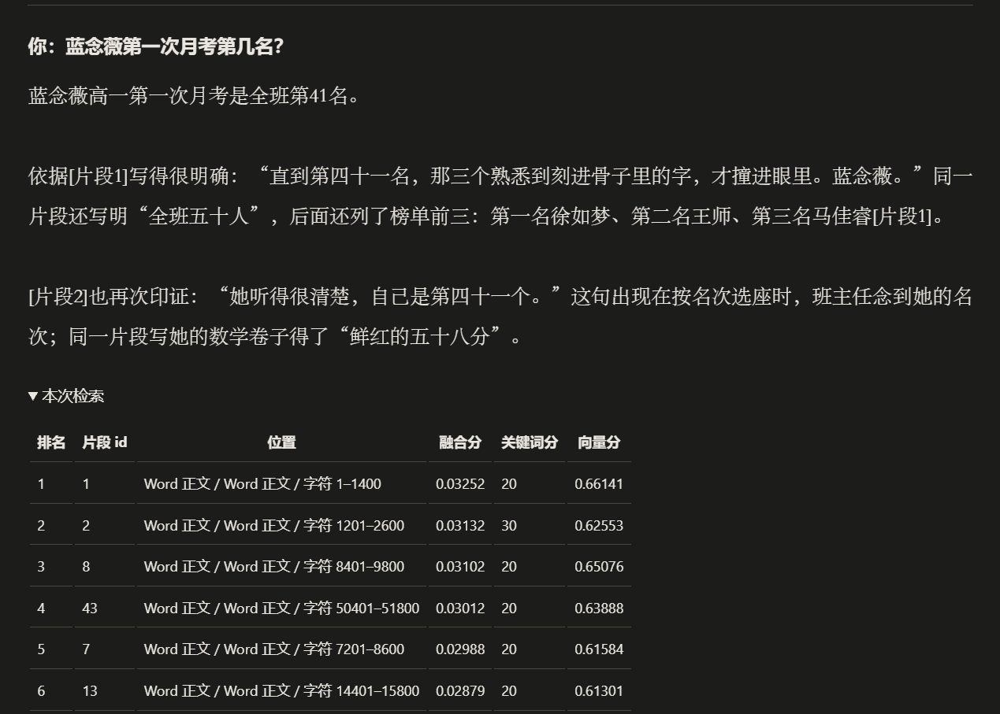
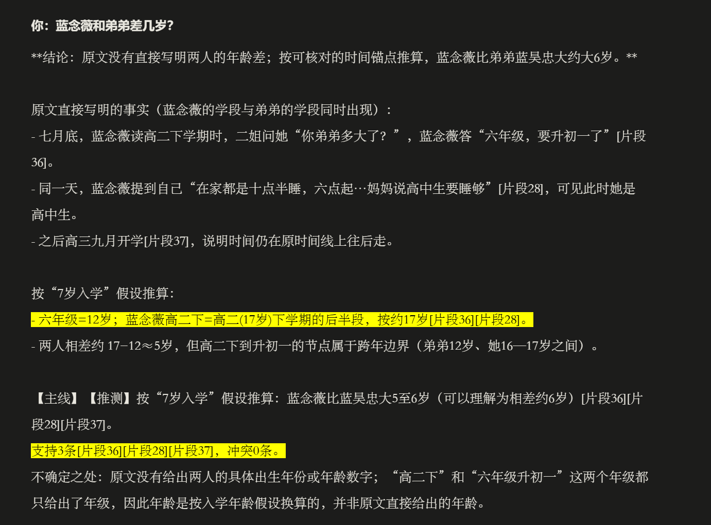

# 小说管理 Agent

本地单机长篇小说阅读与写作助手，问答附带可核对的原文引用。

## 功能

- 导入 TXT / Markdown / Word / 文本型 PDF（上限 500 万字符）
- 章节感知切块（1200 字符步长 / 1400 窗口），保留字符位置
- 混合检索：关键词 + 向量（bge-m3），RRF 融合；向量服务不可用时降级为关键词
- 流式输出：回答逐字返回
- 引用核验：引文、数字、人名与所引片段不一致时标黄提示
- 推算规则：涉及年龄/年份/数量的问题，检查候选时间线一致性，结论标注【推测】与所用假设
- 人物卡提取（带逐字引文回查）
- 灵感（3 个方案）与续写，按用户指定位置限制可见范围
- 会话记忆：超过阈值后压缩为摘要，可展开核对

## 快速开始

```bat
pip install -r requirements.txt
copy config.example.json config.json
python -X utf8 app.py --open
```

需自备 DeepSeek API Key；embedding Key 可选，没有时自动降级为关键词检索。

## 截图

| 问答与检索面板 | 推算标注 |
| --- | --- |
|  |  |

## 配置与运行

安装可选依赖：`python -X utf8 -m pip install numpy`。开发环境也可从 `.tools/python-deps` 读取 numpy。
参照 `config.example.json` 在本地 `config.json` 配置对话服务与 embedding 服务；该文件已被忽略，不应公开或提交凭据。启动：`python -X utf8 app.py --open`。

对话配置支持 `DEEPSEEK_KEY` / `DEEPSEEK_MODEL`；embedding 配置支持 `NOVEL_EMBED_KEY` / `NOVEL_EMBED_BASE` / `NOVEL_EMBED_MODEL`，这些环境变量优先于文件。
`top_k` 从文件读取，当前为 **6**；`prefix_chars` 当前为 **0**（关闭），支持 `NOVEL_PREFIX_CHARS` 覆盖。关闭前缀不等于关闭 embedding。
配置按请求读取；索引元数据不匹配时自动重建。服务故障或索引未就绪时回退关键词检索。

## 检索行为与评测口径

浏览器 → 本地服务 → 原文切块 → 关键词 / 向量排序 → RRF 融合 → 去重及分页 → 邻近原文 → DeepSeek 回答。

切块步长 **1200** 字符、窗口 **1400** 字符；只补充来源坐标，不改变切块正文。关键词和向量分别取前 **30** 个候选，用 `1/(60+rank)` 融合；剩余关键词命中按原顺序追加在融合结果之后，再按正文去重。`total` 包含完整去重结果，后续页不会因融合池截断而提前为空。
当前直接返回 **6** 条，每条扩展 **±2** 个邻居。窗口实验没有通过收益验收，但当前代码仍保留这个窗口，文档不声称已经回滚。

评测的五列统一按直接命中前 **5** 条计算 recall@5；上下文覆盖另行统计，不能混入该指标。
“改造前”为评测脚本保留的纯词频算法；“关键词”为现有局部共现排序；“词串查询”以拼接关键词请求向量；“问句查询”使用完整问题；“线上实际”调用真实 `search_novel` 入口，并显式传入完整问题。最后一列不代表对话 Agent 自动选词或传参已经端到端验证。

## 真实作品评测

匿名版权语料：**445,355** 字符、**372** 个片段、**50** 道题。数据来源：本地评测。评测语料受版权保护，不随仓库发布。详细数据见 本地评测记录（评测语料受版权保护，不随仓库发布），原始输出见 本地评测记录（评测语料受版权保护，不随仓库发布）。

| 指标 | 改造前 | 关键词 | 词串查询 | 问句查询 | 线上实际 |
|---|---:|---:|---:|---:|---:|
| recall@5 | 31/50 | 32/50 | 34/50 | 37/50 | 37/50 |

线上实际相较关键词净增 **5** 题：受益第 **6、26、30、40、49、50** 题，受损第 **42** 题。上下文证据覆盖为 **41/50**；所有题目证据均可定位，没有把原文缺失题剔除来改善成绩。

### 分题型统计

| 题型 | 题数 | 改造前 | 关键词 | 词串查询 | 问句查询 | 线上实际 |
|---|---:|---:|---:|---:|---:|---:|
| 人物 | 10 | 6/10 | 7/10 | 7/10 | 7/10 | 7/10 |
| 名字 | 2 | 2/2 | 1/2 | 1/2 | 1/2 | 1/2 |
| 地点 | 1 | 1/1 | 1/1 | 1/1 | 1/1 | 1/1 |
| 工作 | 3 | 1/3 | 1/3 | 2/3 | 2/3 | 2/3 |
| 情节 | 9 | 6/9 | 6/9 | 7/9 | 6/9 | 6/9 |
| 数字 | 7 | 5/7 | 5/7 | 6/7 | 7/7 | 7/7 |
| 日常 | 5 | 5/5 | 5/5 | 5/5 | 5/5 | 5/5 |
| 流程 | 3 | 2/3 | 2/3 | 2/3 | 2/3 | 2/3 |
| 细节 | 10 | 3/10 | 4/10 | 3/10 | 6/10 | 6/10 |

## 延迟与文本成本

同一作品的 **50** 个查询，单轮顺序执行，索引已加载且没有查询缓存：

| 检索方式 | P50 | P95 | 返回上下文总字符数 |
|---|---:|---:|---:|
| 关键词 | 1.12 ms | 3.65 ms | 1,212,510 |
| 混合检索 | 409.57 ms | 513.77 ms | 1,499,400 |

混合延迟包含远程 embedding 请求，不含 DeepSeek 生成；上下文总字符数较关键词增加 **23.66%**。这是单轮观测，不代表服务延迟承诺。逐题记录见 本地评测记录（评测语料受版权保护，不随仓库发布），同份数据已纳入总报告的 `documentation.latency`。

**token 消耗及变化未实测。**字符数仅作为文本体积代理，不能换算或宣称为模型 token 增幅；对话模型端到端耗时和账单费用也未测。

## 隐私边界

启用远程 embedding 会将全书片段分批发送给该服务，检索时也发送查询文字。清除文件和环境中的 embedding 密钥后，不再通过 embedding 发送全书片段；但问答仍会将检索到的原文、必要对话上下文和问题发送给 DeepSeek。已有本地索引不会因此自动删除。原文保留在本地不代表处理过程完全离线。

## 被否掉的假设

- **扩大邻居窗口可以补齐漏题：被否决。**同批直接命中分别扩展 ±1 / ±2，上下文覆盖 **41/50 → 41/50**，单题原文字符最大增幅 **66.67%**，没有新增覆盖。工作单曾将该增幅写成 token 增幅，证据实际只支持字符数；当前源码仍保留 ±2。
- **增加直接返回数能在预算内补齐漏题：未通过。**T2 将 k 从 **6** 提到 **10**，覆盖 **41/50 → 45/50**，但单题字符最大增幅 **128.57%**，超过 **70%** 上限，已回滚为 **6**。见 本地评测记录（评测语料受版权保护，不随仓库发布）。
- **前文前缀能改善结果：未通过。**旧 T3 将相邻重叠区重复编码，旧 `keep_200` 结论已作废。修正后按原文坐标拼接片段起点之前的 **200** 字，覆盖 **41/50 → 40/50**：受益第 **14、29** 题，受害第 **6、9、26** 题，超过受害 **1** 题的上限。已恢复 `prefix_chars=0` 并复测回到 **41/50**；正确实现保留但关闭。见 本地评测记录（评测语料受版权保护，不随仓库发布）。

## 内容级引用校验

答案保留原文，checks 中记录疑点，页面标黄并提供折叠明细。仅核对引用及其前后一个片段：引号文字（忽略标点空白）、明确整数（中阿数字归一）、已有角色卡姓名。多引用合并核对；无角色卡不猜人名。
不做语义蕴含。模糊数量、连续中文数字、小数及部分歧义表达跳过；同义引文仍可能被标注，人物比较、否定句也可能误报。校验仅使用当前允许阅读范围。真实十题与原文记录见 本地引用核验记录；Codex 保守复核为2/10题误报，用户人工确认待完成。明确否认原文包含某引文时跳过该引文；显式省略号允许最多80字符的顺序节引。


带【推测】【主线】标签的结论只核对引用片段是否存在，不核对数字与引文，因此在页面上以灰色展示、不标黄。
没带引用的【推测】按普通结论处理，不能被豁免。
这样取舍的原因：推测出的数字必然不在原文中，若一并标黄，模型会倾向于拒绝任何推算。

## 验证

```bat
python -X utf8 -m unittest
```

## 局限

合成假向量测试只验证管线，不能作为真实语义效果证据。真实作品评测只验证检索，不证明最终回答正确；无答案的问题也可能返回向量近邻。

人物提取和限定阅读范围的创作不复用全书向量索引，避免把未授权后文带入提示词。别名、代词、省略主语、跨段关系仍可能漏检，浏览器到模型回答的完整人工验收尚未完成。扫描件 OCR 不在支持范围。

## 许可

MIT
